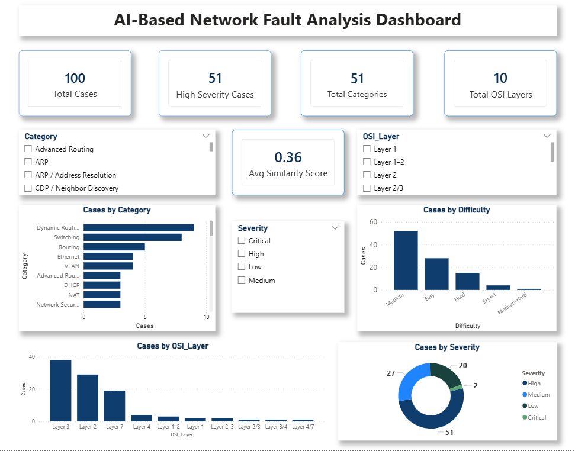

# NetForensics AI – AI-Powered Network Troubleshooting System

## Project Overview

NetForensics AI is an AI-assisted network troubleshooting system developed as part of my Cisco virtual internship learning journey.

The project aims to simplify network fault identification and troubleshooting by combining Artificial Intelligence with fundamental computer networking concepts.

It is designed to analyse network symptoms, topology information and diagnostic command outputs to help identify possible network issues and suggest evidence-based troubleshooting steps.

The system focuses on making network troubleshooting more structured, understandable and efficient.

## Problem Statement

Network troubleshooting can be challenging, especially when identifying the root cause of connectivity issues across different network layers and devices.

Traditional troubleshooting often requires manually examining command outputs, network configurations and device connectivity.

NetForensics AI explores how AI-assisted analysis can support this process by interpreting diagnostic information and providing structured troubleshooting guidance.

## Project Objectives

- Develop an AI-assisted network troubleshooting chatbot.
- Identify possible causes of common network connectivity problems.
- Analyse network symptoms and diagnostic command outputs.
- Relate identified issues to the appropriate OSI layer.
- Suggest relevant troubleshooting commands and corrective actions.
- Support systematic troubleshooting through test cases and documented prompts.

## Key Features

- **AI-Assisted Diagnosis:** Analyses network-related symptoms and diagnostic information.
- **Root Cause Identification:** Suggests possible reasons behind network failures.
- **OSI Layer Mapping:** Helps identify the networking layer associated with an issue.
- **Troubleshooting Guidance:** Recommends relevant diagnostic commands and possible solutions.
- **Evidence-Based Responses:** Uses available diagnostic information to support troubleshooting suggestions.
- **Test Case Validation:** Uses documented networking scenarios to evaluate the system's responses.
- **Analytics Dashboard:** Presents project testing results and troubleshooting-related analysis.

## Technologies and Tools Used

- Python
- Artificial Intelligence
- Prompt Engineering
- Cisco Networking Concepts
- Cisco Packet Tracer
- Streamlit 
- Microsoft Power BI
- CSV Dataset
- Jupyter Notebook 

## Networking Concepts Covered

The project explores troubleshooting scenarios related to:

- Ethernet
- VLAN
- Spanning Tree Protocol (STP)
- OSPF
- BGP
- DHCP
- DNS

## Project Workflow

1. **Problem Identification:** Understand common networking problems and troubleshooting requirements.
2. **Network Scenario Preparation:** Prepare networking scenarios using relevant network configurations and diagnostic information.
3. **Prompt Development:** Design prompts to guide the AI in analysing network-related problems.
4. **AI-Based Analysis:** Process user-provided symptoms, topology details and command outputs.
5. **Diagnosis and Recommendations:** Generate possible causes, OSI layer identification and troubleshooting suggestions.
6. **Testing and Validation:** Evaluate the system using documented network troubleshooting test cases.
7. **Dashboard Development:** Present relevant testing results and project analysis through a Power BI dashboard.
   

## Expected System Output

For a given network troubleshooting scenario, the system is designed to provide:

- Identified network problem or symptom.
- Possible root cause.
- Relevant OSI layer.
- Recommended diagnostic command.
- Supporting evidence.
- Suggested corrective action.

The AI-generated recommendations should be verified by a network administrator or human reviewer before implementation.

## Repository Structure

```text
netforensics-ai/
│
├── README.md
│
├── 01_Project_Report/
│   └── Final Project Report
│
├── 02_Source_Code/
│   └── Python Application Files
│
├── 03_Dataset/
│   └── Network Troubleshooting Data
│
├── 04_Prompts/
│   └── AI Prompt Documentation
│
├── 05_Packet_Tracer_Test_Cases/
│   └── Network Test Scenarios
│
├── 06_Dashboard/
│   └── Power BI Dashboard Files
│
├── 07_Demo Video/
│   └── Project Demonstration
│
└── 08_Certificates/
    └── Relevant Certificates
```

## Project Outcomes

This project provided practical exposure to:

- Applying AI concepts to real-world networking problems.
- Understanding network troubleshooting methodologies.
- Developing structured prompts for AI-assisted analysis.
- Working with Python-based project development.
- Testing and evaluating network troubleshooting scenarios.
- Presenting analytical results through a Power BI dashboard.

## Future Improvements

- Expand the number of network troubleshooting scenarios.
- Improve diagnostic accuracy through additional test cases.
- Integrate more networking protocols and configurations.
- Improve the chatbot interface and user experience.
- Explore integration with real-time network monitoring systems.

## Learning Experience

Through this project, I gained practical experience in combining Artificial Intelligence with Computer Networking. It helped me understand how AI can support technical problem-solving and how structured diagnostic information can be used to generate meaningful troubleshooting recommendations.

## Disclaimer

This project is intended for educational and demonstration purposes. AI-generated troubleshooting suggestions may not always be accurate and should be verified before applying changes to real network infrastructure.

## Author

**Urja Chauhan**

B.Tech Computer Science and Engineering

GitHub: https://github.com/Explorer239

LinkedIn: https://www.linkedin.com/in/urja-chauhan-2841ba428?utm_source=share_via&utm_content=profile&utm_medium=member_android
